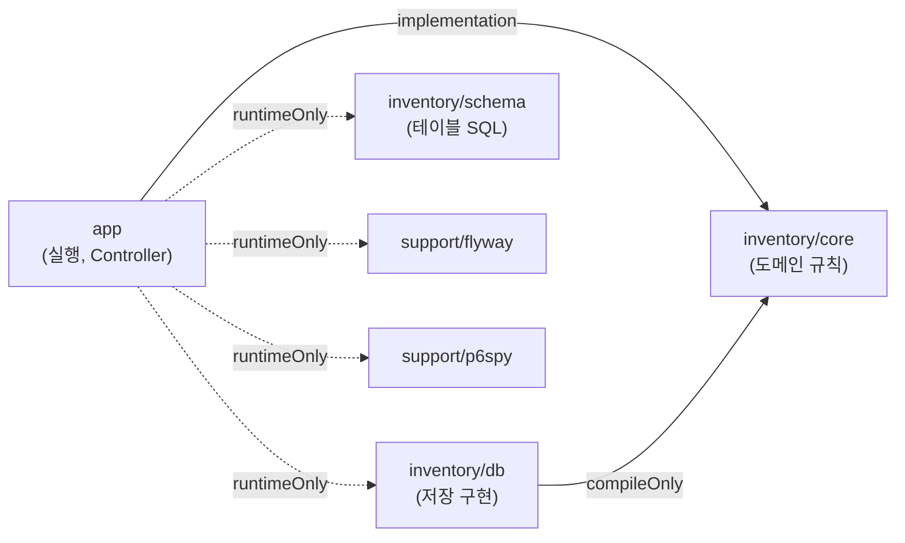

# Inventory Management System

상품 입고, 출고, 재고 조회를 제공하는 재고 관리 API. 여러 회사가 함께 쓰고, 상품과 재고는 회사별로 분리.
목표는 앱 서버 여러 대(Pod)가 같은 DB에서 동시에 요청을 처리해도 재고 정합성 유지.

- **다중 서버 정합성**: 재고 행 잠금, DB 제약, 멱등성 키로 동시 요청과 중복 요청 차단. 앱 3대, 초당 약 1,000회 부하에서도 재고와 원장(입출고 이력) 합계 불일치 0건
- **빌드가 강제하는 모듈 경계**: 도메인 규칙, 저장 구현, 테이블 정의, 실행 모듈을 Gradle 모듈로 분리. 의존 방향을 어기면 컴파일 에러
- **운영 구성 재현**: compose로 앱 3대, nginx, 관측 스택(Loki, Prometheus, Grafana) 구성. 같은 구성을 Helm 차트와 ArgoCD로 k8s에 배포

Java 21, Spring Boot 4.1, Spring Data JPA, PostgreSQL 16, Flyway, Gradle(Kotlin DSL), Docker, Helm, k6

## 목차

1. [구조](#구조)
2. [배포 구조 (k8s)](#배포-구조-k8s)
3. [데이터베이스](#데이터베이스)
4. [동시성과 정합성](#동시성과-정합성)
5. [요구사항 해석과 가정](#요구사항-해석과-가정)
6. [실행 방법](#실행-방법)
7. [개발 방식](#개발-방식)
8. [AI 활용 방식](#ai-활용-방식)
9. [문서](#문서)

---

## 구조

### 모듈




| 모듈                                      | 역할                                                                   |
| --------------------------------------- | -------------------------------------------------------------------- |
| [`app`](app/)                           | Runable한 실행 모듈. 도메인 조립, Controller, 요청과 응답 DTO, 공통 응답과 예외 처리, 로그와 지표 |
| [`inventory/core`](inventory/core/)     | 엔티티와 값 객체, 저장 포트(Store) 인터페이스, 서비스. 재고 부족 같은 규칙은 엔티티가 판단             |
| [`inventory/db`](inventory/db/)         | Store 구현 (Spring Data JPA, native query)                             |
| [`inventory/schema`](inventory/schema/) | 재고 도메인 테이블 마이그레이션 SQL. 테이블 정의의 유일한 원천                                |
| [`support/flyway`](support/flyway/)     | Flyway 실행 의존성, 마이그레이션 이미지(`Dockerfile`)                              |
| [`support/p6spy`](support/p6spy/)       | 로컬 SQL 로그 포매터 (운영에서는 꺼짐)                                             |


- **runtimeOnly 의존**: `app`은 `db`, `schema`, `flyway`, `p6spy`를 실행 시점에만 참조. Controller에서 JPA Repository를 import하면 컴파일 에러
- **도메인 순수성**: `inventory/core`에 Spring Data, 웹, DB 드라이버 없음. 저장소 인터페이스는 도메인 소유, 구현은 `db`
- **엔티티와 JPA 매핑**: 도메인 객체와 JPA 엔티티를 나눠 옮겨 담는 비용 대신 엔티티에 매핑 어노테이션만 허용
- **근거와 비교한 대안**: [멀티모듈 초기 세팅 명세](docs/specs/1-multimodule-setup.md), [모듈을 지금 구조로 바꾼 이유 (#7 명세 PR 계획의 PR 2)](docs/specs/7-inventory-query.md#pr-계획)

### 프로젝트 구조

```
.
├── app/                      실행 모듈 (com.logistics.inventory.api), Dockerfile, http/ API 호출 예시
├── inventory/
│   ├── core/                 도메인 (com.logistics.inventory.domain)
│   ├── db/                   저장 구현 (com.logistics.inventory.db)
│   └── schema/               테이블 마이그레이션 SQL (db/migration/V*.sql)
├── support/
│   ├── flyway/               Flyway 실행 설정, 마이그레이션 이미지 Dockerfile
│   └── p6spy/                로컬 SQL 로그 포매터
├── infra/
│   ├── compose.yaml          PostgreSQL, flyway, 앱 3대, nginx, k6, 관측 스택
│   ├── nginx.conf
│   ├── monitoring/           Alloy, Loki, Prometheus, Grafana 설정과 대시보드
│   ├── helm/                 앱 차트(inventory), 관측 스택 values
│   └── argocd/               ArgoCD Application
├── load-test/                k6 시나리오, 실행 스크립트, 정합성 확인 SQL
├── docs/
│   ├── specs/                이슈별 기능 명세서 (설계 근거와 비교한 대안)
│   ├── conventions/          작업 흐름, Git 규칙
│   ├── ddl.sql               전체 DDL (최종 스키마)
│   └── load-test-result.md   부하 테스트 결과
├── .github/                  CI workflow, 이슈와 PR 템플릿
└── .claude/skills/           AI 작업 규칙 (아래 "AI 활용 방식")
```

---

## 배포 구조 (k8s)


- **GitOps 배포**: main push → CI 테스트와 차트 검사 → 앱, 마이그레이션 이미지를 커밋 SHA 태그로 Docker Hub에 push(amd64, arm64) → 차트 `image.tag`를 그 SHA로 바꿔 main에 커밋 → ArgoCD가 감지해 반영. CI는 클러스터 접근 없음
- **배포마다 마이그레이션 한 번**: Helm hook Job(ArgoCD PreSync)이 앱 Pod보다 먼저 실행. 실패하거나 5분 초과 시 배포 중단, 기존 Pod 유지. ArgoCD 재시도는 한 번. 앱 기동 시 마이그레이션 없음
- **무상태 앱 Pod**: `replicaCount`(기본 3)만 바꿔 확장. 서비스 포트 8080은 Service로, 관리 포트 8081(헬스 체크, 지표)은 probe와 Prometheus만 Pod에 직접 연결. DB 계정은 Secret에서 주입
- **관측**: compose 관측 스택과 같은 구성과 대시보드를 공개 차트(kube-prometheus-stack, Loki, k8s-monitoring)로 구성
- **설치와 운영**: [infra/README.md](infra/README.md) (ArgoCD 배포, 처음 설정, 롤백), [infra/helm/README.md](infra/helm/README.md) (차트 구성, minikube 설치).

---

## 데이터베이스

- **전체 DDL** (테이블, 제약, 인덱스): [`docs/ddl.sql`](docs/ddl.sql). 마이그레이션을 모두 적용한 최종 스키마
- **마이그레이션 원본**: [`inventory/schema/src/main/resources/db/migration/`](inventory/schema/src/main/resources/db/migration/). 버전 번호는 변경을 만든 이슈 번호
- **테이블**
  - `product`: 상품. 회사 코드 + 상품 코드 UNIQUE
  - `inventory`: 상품별 재고 행 하나. 입출고 시 잠금 대상
  - `stock_transaction`: 원장. 입출고마다 한 행, 변경 전후 수량과 요청자
  - `idempotency_record`: 처리한 멱등성 키와 요청 내용. 회사 코드 + 키가 PK

---

## 동시성과 정합성

**전제**: 앱 여러 대(nginx 뒤 3대, k8s에서는 Pod N개), DB는 PostgreSQL 하나. 앱 메모리의 락과 캐시 없이 잠금, 중복 판정, 재고를 모두 DB에서 처리하므로 앱 대수와 무관하게 같은 규칙

### 입고, 출고 한 건의 처리 순서 (한 트랜잭션)

1. **멱등성 키 선점**: `INSERT ... ON CONFLICT DO NOTHING`으로 (회사 코드, 키) 저장. 키는 회사별로 분리
  - 1행: 처음 보는 키, 처리 계속
  - 0행: 이미 처리된 키. 저장된 내용과 같으면 재고 변경 없이 200, 다르면 422
  - 같은 키 동시 요청: 뒤 요청은 키 PK 충돌에서 앞 요청 커밋까지 대기. 앞 요청이 커밋되면 0행으로 종료, 롤백되면 1행으로 처음부터 처리
2. **상품 확인**: 회사 코드 + 상품 코드로 조회. 다른 회사 상품은 없는 상품으로 취급
  - 입고: 없으면 `INSERT ... ON CONFLICT DO NOTHING`으로 등록. INSERT 성공(1행) 트랜잭션만 수량 0인 재고 행 생성, 동시에 등록하려던 요청은 0행을 받고 기존 상품 사용
  - 출고: 없으면 404
3. **재고 행 잠금**: `SELECT ... FOR UPDATE`(JPA 비관적 잠금). 같은 상품 요청은 여기서 순서대로 대기
4. **규칙 판단**: 엔티티(`Inventory.increase`, `decrease`)가 수량 변경, 재고 부족 시 409
5. **원장 기록**: 변경 전후 재고를 원장(`stock_transaction`)에 저장 후 커밋. 실패 시 키, 재고, 원장 모두 롤백되어 같은 키로 재처리 가능

- **잠금 대기 상한 3초**: 모든 커넥션에 `lock_timeout = 3s`. 초과 시 503과 `Retry-After`로 즉시 반환해 커넥션 풀 고갈 방지
- **데드락 없음**: 트랜잭션마다 잠그는 재고 행은 하나
- **DB 제약이 마지막 방어선**: 음수 재고 CHECK, 원장 잔액 CHECK, 회사별 상품 코드 UNIQUE, 회사별 키 PK. 앱 코드에 버그가 있어도 잘못된 커밋 차단

### 검증

**통합 테스트** (실제 PostgreSQL, 멀티스레드 동시 요청): [`InventoryConcurrencyTest`](app/src/test/java/com/logistics/inventory/api/inventory/InventoryConcurrencyTest.java) 


| 시나리오                    | 결과                                  |
| ----------------------- | ----------------------------------- |
| 같은 상품에 입고와 출고 동시 요청     | 재고 = 시작 재고 - 출고 합 + 입고 합, 원장 합계와 일치 |
| 같은 상품에 동시 출고            | 음수 없음, 성공한 출고만큼만 감소                 |
| 처음 보는 상품에 동시 입고         | 상품 하나만 생성                           |
| 같은 키로 동시 입고, 출고         | 재고와 원장에 한 번만 반영, 응답 모두 200          |
| 다른 트랜잭션이 재고 행을 3초 넘게 잠금 | 503, 재고 유지                          |
| 두 회사가 같은 상품 코드에 동시 출고   | 회사별로 음수 없음, 원장 합계와 일치               |


**부하 테스트** (k6 → nginx → 앱 3대 → PostgreSQL, 상품 하나에 입출고 집중, 20%는 같은 키로 재전송): [결과 전체](docs/load-test-result.md)


| 시나리오                          | 요청      | 처리량         | p95       | 정합성 |
| ----------------------------- | ------- | ----------- | --------- | --- |
| load (VU 50명, 60초)            | 50,874  | 844.7 req/s | 172.4ms   | 통과  |
| stress (초당 200 ~ 1,200회)      | 107,437 | 703.9 req/s | 2,737.0ms | 통과  |
| spike (초당 200 → 1,500 → 200회) | 45,213  | 451.3 req/s | 3,002.5ms | 통과  |


- **매 실행 정합성 확인**: 음수 재고 0, 재고와 원장 합계 차이 0, 멱등성 기록 행 수 = 원장 행 수, k6가 200을 받은 키 수 = 원장 행 수(같은 키 이중 반영 0건)
- **처리 한계**: 상품 하나당 약 950 ~ 1,000 req/s. 초과 시 응답 지연, 커넥션 풀 3초 대기 초과 요청은 500. 재고 불일치는 0건
- **측정 시점**: 회사 분리 이전 커밋. 현재 스크립트는 두 회사(`COMPANY-A`, `COMPANY-B`)의 같은 상품 코드에 분산 전송

---

## 요구사항 해석과 가정


| 요구사항            | 해석                                                                                                            |
| --------------- | ------------------------------------------------------------------------------------------------------------- |
| 미등록 상품은 입고 시 등록 | 상품은 `productCode`로 구분. 처음 보는 코드로 입고하면 이름이 코드와 같은 상품 생성, 이름은 이후 `PATCH`로 수정                                    |
| 재고는 음수 불가       | 재고보다 많은 출고는 409로 거절. 부분 출고 없음                                                                                 |
| 요청자 기록          | `X-User-Id` 헤더 값을 원장에 기록. 인증은 범위 밖이라 헤더 값을 신뢰                                                                 |
| 여러 회사가 시스템 공유   | 모든 요청에 `X-Company-Code` 헤더 필수. 상품, 재고, 이력, 멱등성 키를 회사별로 분리하고 다른 회사 상품은 없는 상품과 같은 404. 회사 인증과 등록은 없고 형식이 맞으면 수용 |
| 같은 요청은 한 번만 반영  | `Idempotency-Key`로 판단. 같은 키에 같은 내용이면 200, 다른 내용이면 422                                                         |


| 가정                                  | 이유                                                                                |
| ----------------------------------- | --------------------------------------------------------------------------------- |
| 상품 코드는 대문자, 숫자, 하이픈 1~64자. 소문자는 400 | 그대로 저장하면 `ts-basic`과 `TS-BASIC`이 다른 상품, 대문자로 바꿔 저장하면 보낸 코드와 저장된 코드가 달라 연동 측 조회 실패 |
| 입출고 수량은 1 ~ 1,000,000               | 자릿수 오입력으로 재고가 크게 틀어지는 것 방지                                                        |
| 한 요청에 상품 하나                         | 요구사항 범위 밖                                                                         |
| 실패한 요청은 키 미보관                       | 재고 부족으로 거절된 출고를 같은 키로 재전송하면 그 사이 입고에 따라 성공 가능                                     |
| 멱등성 키 영구 보관                         | 원장처럼 누적. 보관 기간이 필요해지면 별도 정리 작업                                                    |
| 상품명 수정은 잠금 없이 마지막 요청 반영             | 이름은 누적 값이 아니라 통째로 바뀌는 값이라 마지막 요청이 사용자 기대와 일치                                      |


---

## 실행 방법

필요: Docker, 테스트 실행 시 JDK 21

```bash
./gradlew build                   # 테스트. Docker 실행 필요 (Testcontainers가 PostgreSQL 컨테이너 기동)

cd infra
docker compose up -d --build      # PostgreSQL, 마이그레이션, 앱 3대, nginx. 앱은 localhost:8080/api
docker compose down -v            # 종료 및 DB 데이터 삭제
```

- **API 호출 예시**: [`app/http/inventory.http`](app/http/inventory.http). 입고, 출고, 조회, 이력, 상품명 수정, 중복 요청, 재고 부족, 다른 회사 상품 조회 등을 IntelliJ HTTP Client나 VS Code REST Client로 바로 실행
- **Swagger UI**: [http://localhost:8080/api/swagger-ui.html](http://localhost:8080/api/swagger-ui.html) (API 목록, Try it out으로 직접 호출)
- **앱 컨테이너 재생성 후**(`up --build` 등): `docker compose restart nginx`로 nginx가 바뀐 앱 주소를 다시 읽도록 갱신

**부하 테스트** (레포 루트): `./load-test/run.sh [load|stress|spike]`. 기존 compose 구성과 DB 볼륨 삭제 → 새로 기동 → 부하 → 정합성 확인. 정합성이 깨지면 exit 1

**관측 스택 (로그, 메트릭)**

```bash
cd infra
docker compose --profile monitoring up -d --build   # 전체 구성 + Alloy, Loki, Prometheus, Grafana
```

- **Grafana**: [http://localhost:3000](http://localhost:3000) (admin / admin). 첫 화면 `재고 서비스` 대시보드 (재고 변경 건수와 수량, 거절 사유, API p95, replica별 처리량, DB 커넥션, 슬로 쿼리, 경고와 에러 로그)
- **Prometheus**: [http://localhost:9090](http://localhost:9090) (`Status > Targets`에서 앱 replica별 수집 상태)
- **로그 검색** (Grafana Explore, Loki): `{service="app"} | json | traceId="<응답 헤더 X-Request-Id 값>"`
- **쿼리별 누적 시간**: `docker compose exec postgres psql -U inventory -c "SELECT calls, round(total_exec_time) AS ms, query FROM pg_stat_statements ORDER BY total_exec_time DESC LIMIT 10"` (빈 볼륨으로 처음 기동할 때 확장 생성. 이전 볼륨이면 `down -v` 후 재기동)
- **actuator**: 관리 포트 8081에만 있고 호스트에 미노출. 컨테이너 안에서 확인: `docker compose exec app wget -qO- localhost:8081/actuator/health/readiness`

**로컬 개발 (IDE에서 앱 실행)**

```bash
cd infra
docker compose up -d postgres     # DB만 기동. 전체 구성과 함께 띄우면 앱과 nginx가 8080 포트 충돌
```

- `app` 모듈의 `InventoryApplication`을 IDE에서 실행하거나 `./gradlew :app:bootRun`
- 프로파일 미지정 시 local 프로파일: 기동 시 마이그레이션 적용, 정렬된 SQL 로그 출력

**k8s**: [배포 구조](#배포-구조-k8s), [infra/README.md](infra/README.md), [infra/helm/README.md](infra/helm/README.md)

---

## 개발 방식

```
요구사항 이슈 ──▶ 작업 이슈 ──▶ 기능 명세서 ── 승인 ──▶ PR ──▶ dev ──▶ main (배포)
  (무엇이 필요)    (무엇을)     (어떻게 개발할지)        (어떻게 개발했는지)
```

- **이슈 단위 개발**: 요구사항을 세션 하나로 끝낼 크기의 이슈로 분리, 이슈마다 개발 전 기능 명세서(`docs/specs/{이슈번호}-*.md`) 작성. 명세서에 설계, 규칙, 테스트 케이스, **설계별 비교한 대안과 선택 근거** 기록
- **테스트 케이스 추적**: 테스트 케이스 ID(`TC-12-13` 등)로 명세서, 테스트 이름(`@DisplayName`), PR 본문 연결. 이슈를 닫는 PR에서 명세서의 테스트 케이스가 모두 코드에 있는지 스크립트로 확인
- **CI**: dev, main 대상 PR과 push마다 빌드, 테스트, Helm 차트 검사. main push 시 이미지 push와 차트 tag 커밋, ArgoCD가 감지해 배포
- **규칙 문서**: [작업 흐름](docs/conventions/workflow.md), [Git 컨벤션](docs/conventions/git.md)

---

## AI 활용 방식

Claude Code로 개발. 원칙은 두 가지: **결정은 사람, 실행은 AI**, **규칙은 문서가 아니라 빌드와 스크립트로 강제**


| 항목            | 방식                                                                                                                                                                                                   |
| ------------- | ---------------------------------------------------------------------------------------------------------------------------------------------------------------------------------------------------- |
| 역할 분리         | 이슈 범위, 명세서 승인, 머지는 사람이 결정. AI는 요구사항의 빈칸을 질문으로 도출하고 명세서 초안, 구현, 테스트, PR 작성                                                                                                                            |
| 작업 절차의 skill화 | [`.claude/skills/`](.claude/skills/)에 세 가지. `requirement-refinement`(요구사항 → 작은 이슈), `issue-workflow`(이슈 → 명세서 → PR 절차), `inventory-architecture`(모듈 배치, 도메인 모델, 동시성 처리 규칙과 코드 예시). 세션이 바뀌어도 같은 규칙 적용 |
| 빌드로 강제        | 모듈 경계를 Gradle 의존성(`runtimeOnly`, `compileOnly`)으로 강제. AI가 규칙을 어기면 컴파일 실패                                                                                                                             |
| 스크립트로 확인      | [`check-tc-coverage.sh`](.claude/skills/issue-workflow/scripts/check-tc-coverage.sh)로 명세서 테스트 케이스의 코드 반영 확인. CI에서 전체 테스트 실행                                                                          |
| 사람의 검토        | 명세서마다 설계 대안을 비교해 선택, 구현은 커밋 전 diff로 확인. 리뷰로 바뀐 결정은 명세서 "변경 이력"에 기록                                                                                                                                   |


---

## 문서


| 문서                                                           | 내용                                  |
| ------------------------------------------------------------ | ----------------------------------- |
| [docs/specs/](docs/specs/)                                   | 이슈별 기능 명세서. 설계와 근거, 비교한 대안, 테스트 케이스 |
| [docs/ddl.sql](docs/ddl.sql)                                 | 전체 DDL. 테이블, 제약, 인덱스                |
| [docs/load-test-result.md](docs/load-test-result.md)         | k6 부하 테스트 환경, 시나리오, 결과              |
| [docs/conventions/workflow.md](docs/conventions/workflow.md) | 요구사항 → 이슈 → 명세서 → PR 흐름             |
| [docs/conventions/git.md](docs/conventions/git.md)           | 브랜치, 커밋, PR, 머지 규칙                  |
| [infra/README.md](infra/README.md)                           | k8s 배포 (ArgoCD)                     |
| [infra/helm/README.md](infra/helm/README.md)                 | Helm 차트와 관측 스택 설치                   |


