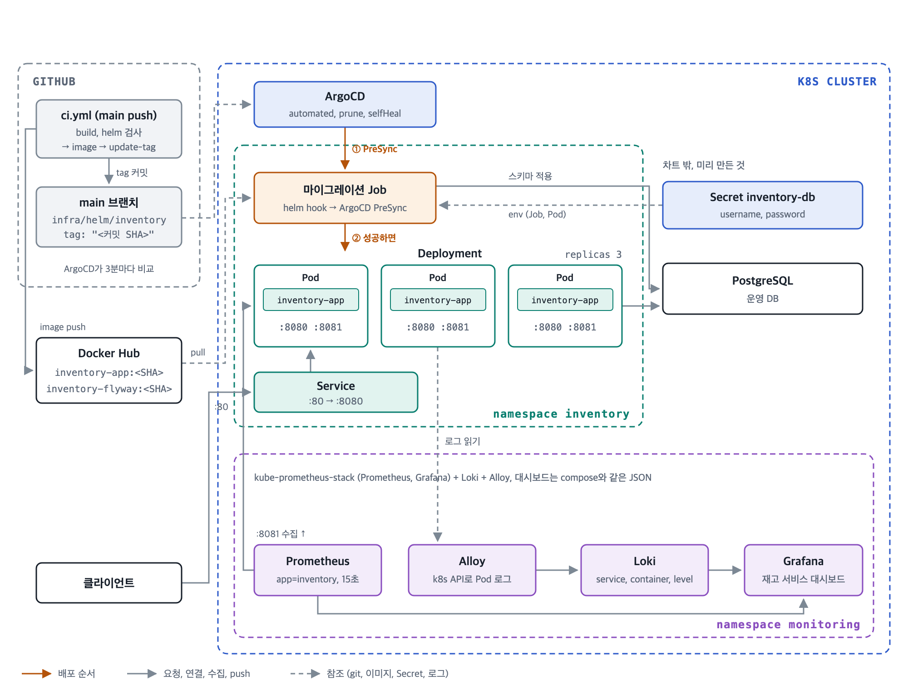

# 기능 명세 — Helm 차트와 배포 자동화 (#23)

### 요구사항 해석
- compose(#17, #22)로 재현한 구성을 k8s로 그대로 옮긴다.
  - 앱을 N대(`replicaCount`)로 띄우고, 각 Pod는 살아 있는지, 준비됐는지 확인을 받는다.
  - DB 계정과 비밀번호는 Secret에 두고 차트는 이름만 참조한다.
  - 마이그레이션은 Pod마다가 아니라 `helm install`, `helm upgrade` 한 번에 한 번만 실행한다.
  - compose `--profile monitoring`과 같은 관측 스택(Prometheus, Grafana, Loki, Alloy)과 같은 대시보드를 k8s에도 띄운다.
- CI는 PR마다 차트를 검사한다. main에 push되면 앱 이미지와 마이그레이션 이미지를 커밋 SHA 태그로 Docker Hub에 올리고, 차트의 이미지 태그를 그 SHA로 바꿔 main에 커밋한다. ArgoCD가 이 변경을 감지해 클러스터에 배포한다(GitOps). 과제 조건상 레포는 하나다.
- k8s 기능은 기초 수준(Deployment, Service, probe, resources, Secret, 공개 차트 설치, ArgoCD Application)으로만 쓴다. PDB, 보안 컨텍스트, preStop, Helm 템플릿 함수 같은 운영 세부 설정은 넣지 않는다.
- 실제 클라우드 배포, Ingress, DB 배포는 하지 않는다. 운영 DB는 이미 있다고 본다.

### 설계



**파일**

| 파일 | 내용 |
|---|---|
| `infra/helm/inventory/Chart.yaml`, `values.yaml` | 차트 이름, 버전(`appVersion` = 이미지 태그 기본값), 대수, 이미지, DB, 리소스 |
| `templates/deployment.yaml` | 앱 Pod (probe 3종, DB env, 롤링 전략) |
| `templates/service.yaml` | 80 → 앱 8080 |
| `templates/migration-job.yaml` | flyway 이미지로 마이그레이션하는 Helm hook Job |
| `infra/helm/monitoring/kube-prometheus-stack.yaml` | Prometheus, Grafana. 앱 지표 수집 job, Loki 데이터소스 추가 |
| `infra/helm/monitoring/loki.yaml` | Loki 단일 바이너리 (compose `loki.yml`과 같은 설정) |
| `infra/helm/monitoring/alloy.yaml` | 앱 Pod 로그를 Loki로 (compose `config.alloy`와 같은 라벨) |
| `.github/workflows/ci.yml` | `helm` job(lint, template, kubeconform). main push 때 `image` job(이미지 빌드, push), `update-tag` job(values의 tag 수정 커밋) |
| `infra/argocd/application.yaml` | ArgoCD Application: 이 레포 main의 `infra/helm/inventory`를 `inventory` namespace에 자동 배포 |
| `infra/helm/README.md` | 설치, 업그레이드, 관측 스택 설치, minikube 확인 명령 |
| `docs/conventions/git.md` | main 직접 push 금지의 예외(CI의 tag 커밋) 한 줄 |

#### 1. 앱 Deployment

| 항목 | 값 | 이유 |
|---|---|---|
| `replicas` | `replicaCount` (기본 3) | compose의 앱 3대 |
| 이미지 | `{repository}:{image.tag}` | tag는 CI가 커밋 SHA로 바꾼다. `latest`는 쓰지 않는다. values.yaml이 바뀌지 않아 ArgoCD가 새 버전을 감지하지 못하고, 어느 버전이 떠 있는지도 알 수 없다 |
| 포트 | `http` 8080, `management` 8081 | 8081은 Service로 열지 않는다. probe와 지표 수집이 Pod에 직접 붙는다 |
| env | `DB_URL`, `DB_POOL_SIZE`, Secret의 `DB_USERNAME`, `DB_PASSWORD` | compose와 같은 이름이라 앱 설정을 바꾸지 않는다 |
| startupProbe | `:8081/actuator/health/liveness`, 2초마다 최대 30번 | 기동하는 20~30초 동안 liveness 실패로 재시작되지 않게 |
| livenessProbe | 같은 주소, 10초마다 | 멈춘 프로세스 재시작. DB는 넣지 않는다(#22): DB 장애 때 모든 Pod가 재시작을 반복한다 |
| readinessProbe | `:8081/actuator/health/readiness`, 5초마다 | 준비 안 된 Pod는 Service에서 뺀다 |
| 롤링 | `maxUnavailable: 0`, `maxSurge: 1` | 새 Pod가 준비된 뒤 기존 Pod를 내린다. 업그레이드 중 처리 가능한 Pod 수가 줄지 않는다 |
| resources | requests cpu 500m, memory 768Mi / limits memory 1Gi | 이미지의 `MaxRAMPercentage=75`로 힙은 limit의 75%. CPU limit은 두지 않는다. JVM은 GC와 JIT에서 CPU를 순간적으로 많이 쓰는데, limit에 걸리면 그 순간 멈춰 응답이 튄다 |

**종료**: preStop은 두지 않는다. 앱이 이미 graceful shutdown(처리 중인 요청을 최대 20초 기다림)이고, k8s 기본 종료 유예 30초 안에 끝난다. minikube에서 요청을 계속 보내면서 롤링 재시작해 실패가 없는 것을 확인했다(아래 검증). 이론상 Pod가 Service에서 빠졌다는 사실이 노드에 퍼지기 전에 들어온 요청은 거절될 수 있다. 실패가 보이면 그때 `preStop: sleep`을 더한다.

#### 2. 마이그레이션 Job (Helm hook)

```yaml
annotations:
  helm.sh/hook: pre-install,pre-upgrade
  helm.sh/hook-delete-policy: before-hook-creation,hook-succeeded
```
- Helm은 이 Job이 끝날 때까지 Deployment를 바꾸지 않는다. Pod가 몇 대든 릴리스마다 Job 하나로 한 번 실행된다.
- 실패하면 `helm upgrade`가 실패하고 Deployment는 이전 버전 그대로다. 실패한 Job은 남아 로그를 볼 수 있다.
- 앱과 같은 태그의 flyway 이미지를 쓴다. 이 앱 버전이 기대하는 스키마가 함께 적용된다.
- compose에서 flyway 컨테이너가 앱보다 먼저 한 번 도는 것(#17)과 같은 구조다.

#### 3. Secret

차트는 Secret 이름(`database.secretName`, 기본 `inventory-db`)만 참조한다. 설치 전에 `kubectl create secret generic inventory-db --from-literal=username=... --from-literal=password=...`로 만든다.

| 안 | 판단 |
|---|---|
| **차트 밖에서 만든 Secret 참조 (선택)** | 비밀번호가 values 파일이나 Helm 릴리스 기록에 남지 않는다. 마이그레이션 Job이 돌 때 Secret이 이미 있다 |
| 차트가 values로 Secret 생성 | 비밀번호가 Helm 릴리스 기록에 남는다. 또 hook Job이 차트의 다른 리소스보다 먼저 돌아서, 그때는 Secret이 아직 없다 |

#### 4. 관측 스택 (compose `--profile monitoring`을 k8s로)

공개 차트를 `helm install`하고, 우리는 values만 둔다. 대시보드는 compose와 같은 `infra/monitoring/grafana/dashboards/inventory.json`을 ConfigMap으로 올린다.

| compose | k8s | 우리가 넣는 설정 |
|---|---|---|
| Prometheus 컨테이너, `dns_sd_configs`로 app 찾기 | kube-prometheus-stack의 Prometheus | `additionalScrapeConfigs`에 inventory job: `app=inventory` Pod마다 `:8081/actuator/prometheus`, 15초 |
| Grafana 컨테이너, 데이터소스 파일 | kube-prometheus-stack의 Grafana | Loki 데이터소스(uid `loki`). Prometheus 데이터소스 uid는 차트 기본값이 `prometheus`라 그대로 맞는다 |
| Loki 컨테이너 | grafana/loki 단일 바이너리 | 파일시스템 저장, 7일 보관 |
| Alloy가 Docker 소켓으로 로그 읽기 | grafana/alloy가 k8s API로 Pod 로그 읽기 | `app=inventory` Pod만, 라벨 `service="app"`, `container`=Pod 이름, `level` |
| 대시보드 파일 마운트 | `grafana_dashboard=1` 라벨 ConfigMap | 같은 JSON |

- kube-prometheus-stack은 학습한 설치 방법(Prometheus와 Grafana를 한 번에 설치, 연결까지 끝난 상태)을 그대로 쓴다. compose에 없던 Alertmanager는 끈다.
- Loki 라벨을 compose와 같게(`service="app"`) 붙여, 대시보드의 로그 쿼리(`{service="app"}`)를 고치지 않고 쓴다.
- Alloy는 하나만 띄워 k8s API로 로그를 읽는다. 노드가 많아지면 노드마다 하나(DaemonSet)로 바꾼다.

#### 5. CI — 차트 검사

| 단계 | 명령 | 잡는 것 |
|---|---|---|
| lint | `helm lint infra/helm/inventory` | 차트 구조, 템플릿 문법 |
| template | `helm template ... > rendered.yaml` | 렌더링 오류 |
| kubeconform | `kubeconform -strict -summary rendered.yaml` | k8s 스키마에 없는 필드, 오타 |

#### 6. 배포 — CI가 이미지와 tag, ArgoCD가 클러스터

```
main push → ci.yml: build(테스트), helm(차트 검사)
          → image: 앱, flyway 이미지를 docker.io/<user>/inventory-app:<커밋 SHA> 등으로 push
          → update-tag: values.yaml의 image.tag를 그 SHA로 바꿔 main에 커밋 ("deploy: inventory <SHA>")
          → ArgoCD: main의 infra/helm/inventory가 바뀐 것을 감지 → PreSync로 마이그레이션 Job → 앱 Pod 롤링
```
- 실습한 GitOps 흐름과 같고, 배포 레포를 따로 두지 않고 이 레포의 차트 경로를 ArgoCD가 본다 (과제 조건: 레포 하나).
- CI는 클러스터 권한이 없다. 배포는 git 변경이고, 롤백은 tag를 되돌리는 커밋이다.
- `update-tag`가 main에 직접 커밋한다. `GITHUB_TOKEN`으로 push한 커밋은 workflow를 다시 실행하지 않아 반복되지 않는다. 이 커밋은 main에만 있고 dev에는 없다. 다음 dev → main 머지 때 dev는 tag 줄을 바꾸지 않았으므로 충돌 없이 main의 값이 남는다. 규칙 문서에 "main 직접 push 금지"의 예외로 적는다.
- Helm hook(`pre-install,pre-upgrade`)은 ArgoCD가 PreSync hook으로 실행한다. Job이 실패하면 Sync가 멈추고 기존 Pod는 그대로다.
- 레지스트리는 실습과 같은 Docker Hub (`vars.DOCKERHUB_USERNAME`, `secrets.DOCKERHUB_TOKEN`). 공개 이미지라 클러스터에서 pull할 때 인증이 필요 없다. 플랫폼은 `linux/amd64`(Dockerfile 안의 Gradle 빌드를 arm64 에뮬레이션으로 돌리면 수십 분 걸린다).
- 레포가 비공개인 동안은 ArgoCD에 읽기 토큰으로 레포를 등록해야 한다 (README).

레포 구성 비교:

| 안 | 판단 |
|---|---|
| **앱 레포 하나 (선택)** | 과제 조건. ArgoCD가 이 레포의 차트 경로를 본다. 대가로 CI 봇이 main에 직접 커밋한다 |
| 배포 레포 분리 (실습) | 일반적인 방식. tag 커밋이 앱 이력에 섞이지 않고 main 직접 push가 없다. 레포가 둘이 되어 과제 조건에 맞지 않는다 |

### 비즈니스 규칙
- R1. `replicaCount`만큼 앱 Pod가 뜨고, 각 Pod는 관리 포트의 startup, liveness, readiness probe를 받는다.
- R2. 마이그레이션은 `helm install`, `helm upgrade`마다 Job 하나로 한 번 실행되고, 끝난 뒤에 앱 Pod가 바뀐다. Pod 수와 무관하다.
- R3. 마이그레이션이 실패하면 앱 Pod는 이전 버전 그대로다.
- R4. 롤링 업데이트 중에도 요청이 실패하지 않는다.
- R5. DB 계정, 비밀번호는 Secret에서 읽고 레포에는 없다.
- R6. PR마다 CI가 차트를 lint, template, kubeconform으로 검사한다.
- R7. main에 push되면 앱, flyway 이미지가 같은 커밋 SHA 태그로 Docker Hub에 올라가고, values.yaml의 tag가 그 SHA로 바뀐다.
- R9. ArgoCD가 바뀐 values.yaml을 감지해 마이그레이션 Job → 앱 Pod 순서로 배포한다.
- R8. k8s의 Grafana에서 compose와 같은 대시보드로 앱 Pod별 지표와 로그를 본다.

### 예외 케이스
| 상황 | 결과 |
|---|---|
| Secret이 없는 상태로 설치 | 마이그레이션 Job Pod가 `CreateContainerConfigError`로 멈추고 설치가 실패한다 (README에 Secret 먼저) |
| DB에 연결 안 됨 | flyway가 10번 재시도 후 실패, Job 실패, 설치 실패 |
| `replicaCount`만 바꾸는 `helm upgrade` | Job이 한 번 더 돌지만 적용할 것이 없어 바로 끝난다 |
| Pod가 수집 전에 교체됨 | 마지막 수집(15초) 뒤의 카운터 증가는 사라진다. Pod 안 메모리에 있던 값이라서다 |

### 검증 방법
차트와 workflow는 Java 테스트 코드로 만들 수 없어 실행해서 확인한다.

**CI, 정적 검사**
| 대상 규칙 | 실행 | 기대 결과 |
|---|---|---|
| R6 | 이 PR의 CI | `helm` job 성공 |
| R5 | `grep -ri password infra/helm` | Secret 키 이름만, 값 없음 |

**minikube (수동)** — `infra/helm/README.md`의 로컬 확인 명령
| 대상 규칙 | 실행 | 기대 결과 |
|---|---|---|
| R1, R2 | `helm install` | Job 1개 완료 후 Pod Ready, 마이그레이션 이력 적용 |
| R2 | `helm upgrade --set replicaCount=5` | Job 1개만 실행, 이력 그대로, Pod 5개 |
| R3 | 문법 오류 SQL을 넣은 flyway 이미지로 `helm upgrade` (확인 후 되돌림) | upgrade 실패, 기존 Pod 그대로, Job 로그 남음 |
| R4 | 클러스터 안 curl Pod로 요청을 계속 보내며 `kubectl rollout restart` | 실패 0 |
| R8 | 관측 스택 설치 후 입고, 출고, 재고 부족, 잠금 대기 출고 | Prometheus inventory job에 Pod마다 UP, 지표 증가, Loki에서 traceId로 슬로 쿼리 로그, 대시보드 "재고 서비스" |

**main 머지 후 (Docker Hub 변수, ArgoCD 레포 등록 필요)**
| 대상 규칙 | 실행 | 기대 결과 |
|---|---|---|
| R7 | dev → main 머지 | `image`, `update-tag` job 성공, Docker Hub에 두 이미지 `<SHA>`, main에 `deploy: inventory <SHA>` 커밋 |
| R9 | ArgoCD Application 등록 후 위 커밋 | Application Synced, Healthy. `inventory` namespace에 Job 완료 후 Pod Ready |

### PR 계획
| PR | 브랜치 | 범위 | 검증 |
|---|---|---|---|
| 1 | `chore/23-helm-deploy` | 앱 차트, ArgoCD Application, 관측 스택 values, CI(`helm`, `image`, `update-tag`), README, 규칙 문서, 명세서 (`Closes #23`) | 위 CI, minikube. R7, R9는 main 머지 후 확인 |

### 범위 밖
- PDB, HPA, 보안 컨텍스트, preStop, Ingress, TLS, 클라우드 배포, PostgreSQL 배포
- ArgoCD 웹훅(push 즉시 반영). 기본 3분 주기 확인으로 둔다
- 관측 스택 values의 CI 검사 (공개 차트 저장소를 받아야 해서 README 명령으로 로컬 확인)

### 결정 필요
- 없음

### 변경 이력
- 2026-10-16: 이미지 배포 시점을 main push에서 배포 태그(`v*.*.*`) push로 바꿈. 이미지 태그도 `sha-`에서 버전(`1.2.3`)으로
- 2026-10-16: k8s 기능을 기초 수준으로 줄임 (PDB, 보안 컨텍스트, preStop, `_helpers.tpl`, `required` 제거, 이미지 태그 기본값은 `appVersion`). 관측 스택(kube-prometheus-stack, Loki, Alloy)과 compose 대시보드를 k8s에도 추가
- 2026-10-16: 배포를 실습과 같은 GitOps로 바꿈. main push → 커밋 SHA 이미지(Docker Hub) → CI가 values.yaml tag 커밋 → ArgoCD 자동 배포. 배포 태그 방식과 release.yml 제거. 레포는 과제 조건대로 하나
